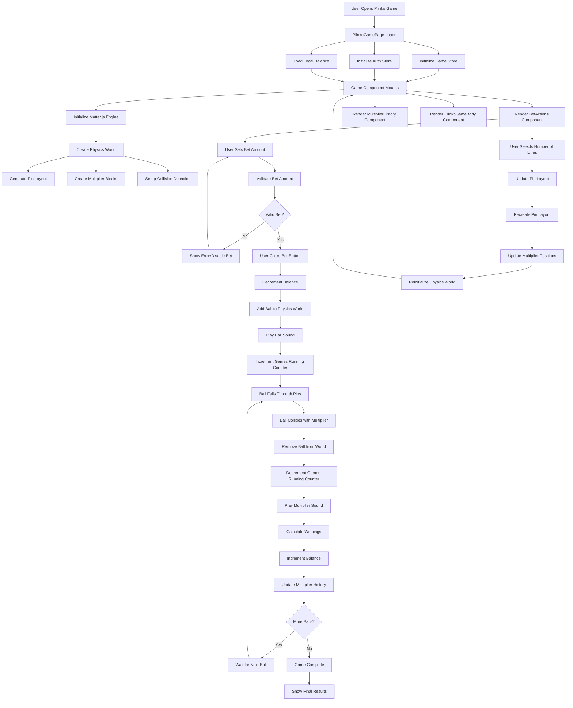

<!-- @format -->

# Plinko Game Workflow Documentation

## Overview

The Plinko game is a physics-based gambling game built with React, TypeScript, and Matter.js. Players drop balls that bounce off pins and land on multipliers to win prizes.

## Canvas Implementation

### Canvas Creation and Management

The Plinko game uses **Matter.js** to create and manage a canvas element for physics rendering. Here's how the canvas is implemented:

#### 1. Canvas Container

```tsx
// src/games/plinko/components/Game/components/GameBody/index.tsx
export function PlinkoGameBody() {
  return <div id='plinko' />;
}
```

#### 2. Canvas Initialization

```tsx
// src/games/plinko/components/Game/index.tsx
useEffect(() => {
  engine.gravity.y = engineConfig.engineGravity;
  const element = document.getElementById("plinko");
  const render = Render.create({
    element: element!, // Canvas is attached to this DOM element
    bounds: {
      max: { y: worldHeight, x: worldWidth },
      min: { y: 0, x: 0 },
    },
    options: {
      background: colors.background,
      hasBounds: true,
      width: worldWidth, // 390px
      height: worldHeight, // 390px
      wireframes: false,
    },
    engine,
  });

  const runner = Runner.create();
  Runner.run(runner, engine);
  Render.run(render);

  return () => {
    World.clear(engine.world, true);
    Engine.clear(engine);
    render.canvas.remove(); // Cleanup canvas on unmount
    render.textures = {};
  };
}, [lines]);
```

#### 3. Canvas Properties

- **Size**: 390x390 pixels (configurable in `worldConfig`)
- **Background**: Theme-based background color
- **Wireframes**: Disabled for better visual appearance
- **Bounds**: Limited rendering area for performance
- **Element**: Attached to `<div id="plinko">` container

#### 4. Canvas Cleanup

The canvas is properly cleaned up when the component unmounts:

- Removes all physics bodies from the world
- Clears the Matter.js engine
- Removes the canvas element from DOM
- Clears texture cache

### Canvas Rendering Elements

#### 1. Pins (Static Circles)

```tsx
const pin = Bodies.circle(pinX, pinY, pinsConfig.pinSize, {
  label: `pin-${i}`,
  render: {
    fillStyle: "#F5DCFF", // Light purple color
  },
  isStatic: true,
});
```

#### 2. Balls (Dynamic Circles)

```tsx
const ball = Bodies.circle(ballX, 20, ballConfig.ballSize, {
  restitution: 1,
  friction: 0.6,
  label: `ball-${ballValue}`,
  render: {
    fillStyle: ballColor, // Purple or text color based on bet value
  },
  isStatic: false,
});
```

#### 3. Multiplier Blocks (Static Rectangles with Sprites)

```tsx
const multiplierBody = Bodies.rectangle(
  lastMultiplierX + 20,
  worldWidth / lines + lines * pinsConfig.pinGap + pinsConfig.pinGap,
  blockSize, // 20px
  blockSize, // 20px
  {
    label: multiplier.label,
    isStatic: true,
    render: {
      sprite: {
        xScale: 1,
        yScale: 1,
        texture:
          typeof multiplier.img === "string"
            ? multiplier.img
            : multiplier.img.src,
      },
    },
  }
);
```

#### 4. Invisible Walls and Floor

```tsx
// Invisible walls for ball containment
const leftWall = Bodies.rectangle(/* ... */, {
  render: { visible: false },
  isStatic: true
})

const floor = Bodies.rectangle(/* ... */, {
  render: { visible: false },
  isStatic: true
})
```

### Canvas Performance Optimizations

1. **Static Bodies**: Pins, walls, and multiplier blocks are static (no physics calculations)
2. **Limited Bounds**: Canvas rendering is bounded to game area
3. **Ball Cleanup**: Balls are removed immediately after collision
4. **Texture Management**: Proper texture cleanup on unmount
5. **Collision Filtering**: Balls use collision groups to optimize detection

### Canvas Integration with React

The canvas is seamlessly integrated with React through:

- **useEffect Hook**: Canvas lifecycle management
- **DOM Element Reference**: Canvas attached to React-managed div
- **State Synchronization**: Canvas updates when game state changes
- **Cleanup**: Proper cleanup when component unmounts

## Architecture Overview

```
┌─────────────────────────────────────────────────────────────────┐
│                        Plinko Game Architecture                 │
├─────────────────────────────────────────────────────────────────┤
│                                                                 │
│  ┌─────────────────┐    ┌─────────────────┐    ┌──────────────┐ │
│  │   PlinkoGamePage│    │      Game       │    │   BetActions │ │
│  │   (Entry Point) │───▶│  (Main Logic)   │◄───│  (Betting UI)│ │
│  └─────────────────┘    └─────────────────┘    └──────────────┘ │
│           │                       │                       │     │
│           │                       │                       │     │
│           ▼                       ▼                       ▼     │
│  ┌─────────────────┐    ┌─────────────────┐    ┌──────────────┐ │
│  │   Game Store    │    │   Matter.js     │    │  Auth Store  │ │
│  │  (Game State)   │    │  (Physics)      │    │ (Balance)    │ │
│  └─────────────────┘    └─────────────────┘    └──────────────┘ │
│                                                                 │
└─────────────────────────────────────────────────────────────────┘
```

## Detailed Workflow Diagram



## Component Structure

### 1. PlinkoGamePage (Entry Point)

- **File**: `src/games/plinko/index.tsx`
- **Purpose**: Main entry point with page-level logic
- **Key Features**:
  - Beforeunload event handler to prevent accidental navigation
  - Games running counter management
  - Renders the main Game component

### 2. Game Component (Core Logic)

- **File**: `src/games/plinko/components/Game/index.tsx`
- **Purpose**: Main game logic and physics simulation
- **Key Features**:
  - Matter.js physics engine setup
  - Pin and multiplier generation
  - Ball physics and collision handling
  - Game state management
  - Audio playback

### 3. BetActions Component

- **File**: `src/games/plinko/components/Game/components/BetActions/index.tsx`
- **Purpose**: Betting interface and controls
- **Key Features**:
  - Bet amount input with validation
  - Quick bet buttons (½, 2x, Max)
  - Lines selection (8-16 lines)
  - Balance display and validation
  - Bet execution

### 4. MultiplierHistory Component

- **File**: `src/games/plinko/components/Game/components/MultiplierHistory/`
- **Purpose**: Display recent multiplier results
- **Key Features**:
  - Shows last 4 multiplier results
  - Visual multiplier indicators

### 5. PlinkoGameBody Component

- **File**: `src/games/plinko/components/Game/components/GameBody/`
- **Purpose**: Physics world rendering
- **Key Features**:
  - Matter.js canvas rendering
  - Visual game elements

## State Management

### Game Store (`src/store/plinko/store/game.ts`)

```typescript
interface Game {
  gamesRunning: number;
  setGamesRunning: (gamesRunning: number) => void;
  incrementGamesRunning: () => void;
  decrementGamesRunning: () => void;
}
```

### Auth Store (`src/store/plinko/store/auth.ts`)

```typescript
interface State {
  wallet: {
    balance: number;
  };
  isWalletLoading: boolean;
  setBalance: (balance: number) => void;
  incrementBalance: (amount: number) => void;
  decrementBalance: (amount: number) => void;
}
```

## Configuration

### Game Config (`src/games/plinko/components/Game/config/index.ts`)

```typescript
const config = {
  pins: {
    startPins: 3,
    pinSize: 2,
    pinGap: 20
  },
  ball: {
    ballSize: 5.7
  },
  engine: {
    engineGravity: 1.0
  },
  world: {
    width: 390,
    height: 390
  },
  colors: // Theme colors
}
```

### Multipliers Config (`src/games/plinko/components/Game/config/multipliers.ts`)

- **Multiplier Values**: 0.3x, 0.5x, 1x, 1.5x, 2x, 3x, 5x, 10x, 15x, 18x, 25x, 33x, 41x, 88x, 110x
- **Line Configurations**: Different multiplier layouts for 8-16 lines
- **Sound Effects**: Different audio for different multiplier categories

## Key Game Mechanics

### 1. Ball Physics

- **Engine**: Matter.js physics engine
- **Gravity**: 1.0 (configurable)
- **Ball Properties**:
  - Size: 5.7px radius
  - Friction: 0.6
  - Air resistance: 0.05
  - Restitution: 1.0 (bouncy)

### 2. Pin Layout Generation

- **Algorithm**: Dynamic pin generation based on line count
- **Pattern**: Triangular layout with increasing pins per row
- **Constraints**: Maximum 15 balls in play simultaneously

### 3. Multiplier System

- **Distribution**: Symmetrical layout for fair odds
- **Categories**:
  - **Best**: 110x, 88x, 41x, 33x, 25x
  - **Good**: 18x, 15x, 10x, 5x
  - **Regular**: 3x, 2x, 1.5x, 1x
  - **Low**: 0.5x, 0.3x

### 4. Betting System

- **Validation**:
  - Must have sufficient balance
  - Maximum 15 balls in play
  - Positive bet amount required
- **Quick Actions**: Half, Double, Max bet options
- **Lines Selection**: 8-16 lines affecting multiplier distribution

## Audio System

### Sound Effects

- **Ball Drop**: `ball.wav`
- **Multiplier Sounds**:
  - **Best**: `multiplier-best.wav` (110x, 88x, 41x, 33x, 25x)
  - **Good**: `multiplier-good.wav` (18x, 15x, 10x, 5x)
  - **Regular**: `multiplier-regular.wav` (3x, 2x, 1.5x, 1x)
  - **Low**: `multiplier-low.wav` (0.5x, 0.3x)

## Error Handling

### Validation Checks

1. **Balance Validation**: Ensure sufficient funds before betting
2. **Ball Limit**: Maximum 15 balls in play
3. **Input Validation**: Positive bet amounts only
4. **State Consistency**: Prevent actions during loading states

### Error Recovery

- **Physics Errors**: Reinitialize Matter.js engine
- **Audio Errors**: Graceful fallback for sound effects
- **State Errors**: Reset to safe default states

## Performance Considerations

### Optimization Strategies

1. **Ball Cleanup**: Automatic removal after collision
2. **Physics Optimization**: Static pins and walls
3. **Audio Management**: Volume control and cleanup
4. **Memory Management**: Proper Matter.js cleanup on unmount

### Limitations

- **Maximum Balls**: 15 concurrent balls limit
- **Physics Complexity**: Matter.js performance constraints
- **Audio Concurrency**: Browser audio limitations

## Future Enhancements

### Potential Improvements

1. **Mobile Optimization**: Touch controls and responsive design
2. **Animation Enhancements**: Particle effects and visual feedback
3. **Social Features**: Leaderboards and sharing
4. **Customization**: Theme selection and personalization
5. **Analytics**: Game statistics and performance tracking

## Testing Strategy

### Test Coverage Areas

1. **Component Testing**: React component behavior
2. **Physics Testing**: Matter.js simulation accuracy
3. **State Management**: Zustand store operations
4. **User Interactions**: Betting and game flow
5. **Error Scenarios**: Edge cases and error handling

### Test Files Structure

```
__tests__/
├── games/
│   └── plinko/
│       ├── components/
│       ├── store/
│       └── utils/
```

This documentation provides a comprehensive overview of the Plinko game architecture, workflow, and implementation details for developers working on the project.
